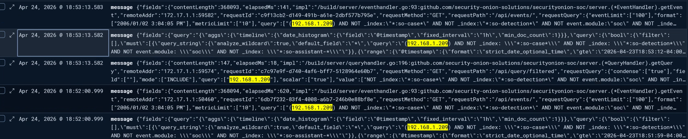
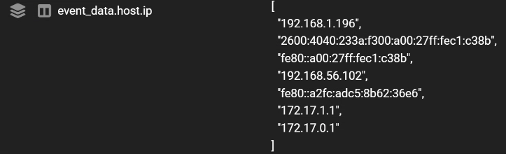
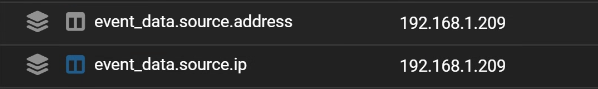
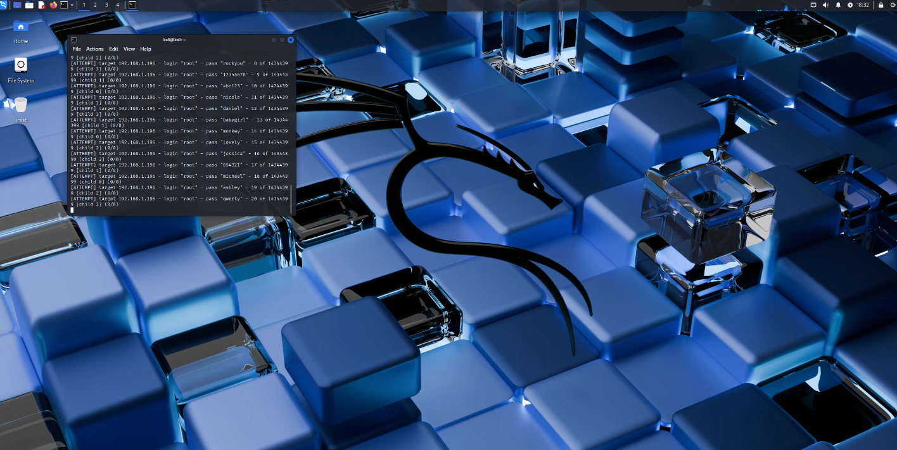
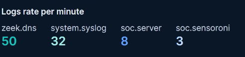
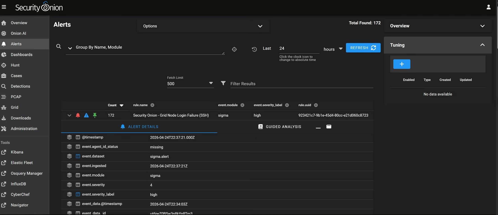
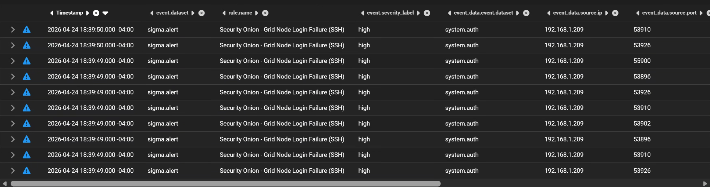

# 🔐 Security Onion Home Lab — Attack Detection & Incident Response


**Author:** Bryan Sykes | **Date:** April 2026
**Platform:** Security Onion 2.4.211 (EVAL) · Oracle VirtualBox · Kali Linux
**Type:** Blue Team / SOC analysis / threat detection

Full write-ups: [`docs/incident-report-IR-2026-0424-001.pdf`](docs/incident-report-IR-2026-0424-001.pdf) and [`docs/security-onion-setup-documentation.pdf`](docs/security-onion-setup-documentation.pdf)

---

## Project Overview

This project is a full attack-and-detect simulation in a self-built home lab. I played both roles: attacker (red team) running network reconnaissance and a credential brute-force attempt, and defender (blue team) detecting, investigating, and documenting that activity in Security Onion.

Result: Sigma generated 172 HIGH-severity alerts (the dashboard screenshot below shows this count; see [Note on alert counts](#note-on-alert-counts) for why the original write-ups say 404), Zeek network logs were correlated against them, and a formal SOC incident report was produced end to end.

---

## Lab Architecture

```
┌─────────────────────────────────────────────┐
│              Windows 11 Host PC              │
│                                               │
│  ┌──────────────────┐   ┌──────────────────┐ │
│  │   Kali Linux VM  │   │ Security Onion VM│ │
│  │  (Attacker)      │   │  (Defender)      │ │
│  └────────┬─────────┘   └────────┬─────────┘ │
│           │                      │            │
│           └──── Bridged ─────────┘            │
│              (home network LAN)               │
└─────────────────────────────────────────────┘
```

| Component | Details |
|---|---|
| Host OS | Windows 11 |
| Hypervisor | Oracle VirtualBox |
| Attacker VM | Kali Linux, bridged adapter |
| Defender VM | Security Onion 2.4.211 EVAL, bridged adapter |
| Base OS (SO) | Oracle Linux Server 9.7 |
| Detection engine | Suricata IDS + Sigma rules + Zeek + Kibana |

IP addresses are on an isolated home-lab LAN segment and are omitted here; they're in the incident report PDF for anyone who wants the full technical detail.

---

## Project Phases

**Phase 1 — Lab setup.** Installed Security Onion 2.4 in EVAL mode, configured bridged networking for a host-accessible management IP, deployed Kali on the same segment, verified connectivity.

**Phase 2 — Network reconnaissance.** Ran a set of Nmap scans from Kali against the Security Onion node (host discovery, service/version detection, OS fingerprinting). Finding: SSH (OpenSSH 8.7) was the only open service; the host fingerprinted as Linux.

**Phase 3 — SSH brute force.** Ran a dictionary-based credential attack against SSH using Hydra and the rockyou wordlist. About 340 attempts were made before manual termination. Zero valid credentials were found — SSH held.

**Phase 4 — Detection and investigation.** Switched to the defender role and investigated the activity in Security Onion.

| Detection source | Finding |
|---|---|
| Sigma alerts | "Grid Node Login Failure (SSH)" — see [Note on alert counts](#note-on-alert-counts) |
| Zeek DNS logs | 50 DNS query events attributed to the attacker IP |
| Kibana | Cross-source correlation confirmed the full attacker timeline |
| Alert window | 2026-04-24, roughly 73 minutes |

**Phase 5 — Incident report.** Produced a formal SOC incident report: executive summary and severity, full attack timeline, technical analysis of both attack phases, an IOC table, detection evidence from every log source, and remediation recommendations.

---

## Indicators of Compromise (IOCs)

| IOC type | Value |
|---|---|
| Target port | 22 (TCP/SSH) |
| Service targeted | OpenSSH 8.7 |
| Username attacked | root |
| Recon tool | Nmap 7.95 |
| Brute-force tool | Hydra v9.5 |
| Wordlist | rockyou.txt |
| Attack window | ~73 minutes |
| Outcome | 0 credentials compromised |

Source and target IPs are in the incident report PDF rather than repeated here.

---

## Tools Used

**Offensive:** Nmap 7.95 (recon and port scanning), Hydra v9.5 (SSH credential brute force), rockyou.txt (dictionary wordlist).

**Defensive:** Security Onion 2.4 (SIEM/NSM platform), Suricata (network IDS), Sigma (detection rules), Zeek (traffic analysis and protocol logging), Kibana (log visualization and cross-source investigation), Elasticsearch (log indexing and search).

---

## Screenshots

| # | Screenshot | What it shows |
|---|---|---|
| 00 |  | Kali desktop with an active terminal session |
| 01 |  | Security Onion node identified in event data |
| 02 |  | Query by Elastalert showing the defender node's addresses |
| 03 |  | Attacker source address isolated in event data |
| 04 |  | Hydra running the SSH brute-force attempt from Kali |
| 05 |  | Log ingest rates per minute across Zeek DNS, syslog, and SOC services |
| 06 |  | Alerts dashboard: 172 "Grid Node Login Failure (SSH)" alerts, high severity |
| 07 |  | Sigma alert detail with timestamp and severity fields |

---

## Troubleshooting Log

| # | Issue | Root cause | Resolution |
|---|---|---|---|
| 1 | `VERR_ALREADY_EXISTS` on first boot | VirtualBox's unattended-install feature auto-generated kickstart files that conflicted with the Security Onion installer | Deleted the generated files, recreated the VM with "Skip Unattended Installation" checked |
| 2 | Forgotten admin username | Username forgotten after the initial install | Booted into single-user mode via GRUB, remounted root read-write, listed `/home` to recover the username, reset the password |
| 3 | Install failed, insufficient disk | Virtual disk was 100 GB, below Security Onion's 200 GB minimum | Recreated the VM with a 200 GB disk |
| 4 | Web UI unreachable on NAT networking | NAT assigned an internal address unreachable from the host browser; port forwarding, host-only networking, and firewall commands didn't fix it | Switched the adapter to Bridged, then ran `so-ip-update` so Security Onion recognized the new address |
| 5 | Kali couldn't reach Security Onion | Kali was on an Internal Network adapter while Security Onion was Bridged — different segments | Switched Kali to Bridged so both VMs got DHCP addresses on the same home-network subnet |

---

## Incident Report Summary

- **Incident ID:** IR-2026-0424-001
- **Severity:** HIGH
- **Detection engine:** Sigma
- **Attack duration:** ~73 minutes
- **Outcome:** Attack fully detected, 0 credentials compromised, status closed as a simulated lab exercise

---

## Note on alert counts

The original incident report and setup documentation (both still in `docs/`) report 404 Sigma alerts. The alerts dashboard screenshot in this repo shows **172** alerts for the same "Grid Node Login Failure (SSH)" rule. I'm flagging the discrepancy here rather than picking one number silently — if you're the one reading this for a hiring decision, the dashboard screenshot is the primary evidence; the PDFs may reflect a different query window or an alert count taken at a different point in triage.

---

## Skills Demonstrated

Network intrusion detection (IDS), SIEM alert triage and investigation, network traffic analysis (Zeek), log correlation across multiple sources (Kibana/Elasticsearch), threat detection and incident response, network reconnaissance technique recognition, credential-attack recognition, Linux system administration (Oracle Linux and Kali), virtual network architecture, the SOC analyst workflow from detection through documentation, and formal incident report writing.

---

## Repository Layout

```
.
├── README.md
├── docs/
│   ├── incident-report-IR-2026-0424-001.pdf
│   └── security-onion-setup-documentation.pdf
└── screenshots/
```

---

## Related Projects

- [Active Directory Home Lab: Phase 2, Attack Simulation & Detection](https://github.com/MrBSykes/active-directory-home-lab-phase-2-attack-simulation-and-detection)
- [AWS GuardDuty Threat Detection](https://github.com/MrBSykes/aws-guardduty-threat-detection)

---

*Bryan Sykes | Northern Virginia | 2026*
*Targeting roles in SOC analysis, IT support, cybersecurity, and blue team operations*
